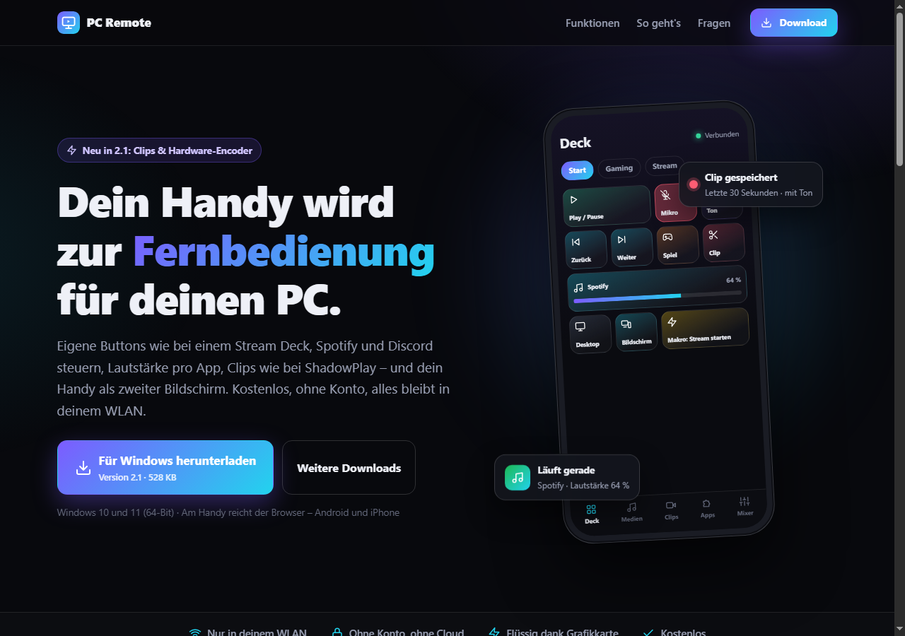

# PC Remote

**Dein Handy wird zur Fernbedienung für deinen Windows-PC** – eigene Buttons wie bei einem Stream Deck, Spotify und Discord steuern, Lautstärke pro App, Clips wie bei ShadowPlay und das Handy als zweiter Bildschirm. Kostenlos, ohne Konto, alles bleibt in deinem WLAN.

**[Website](https://knicklicht114.github.io/pc-remote/)** · **[Download (Version 2.1)](https://github.com/knicklicht114/pc-remote/releases/latest/download/PCRemote-Setup.exe)** · [Alle Versionen](https://github.com/knicklicht114/pc-remote/releases)

## Funktionen

- **Deck** – Buttons frei aufs Raster legen, Seiten, Makros, Tastenkürzel, Programme, Webseiten, Energie
- **Medien & Spotify** – Cover, Spulen, Playlists, Suche, Warteschlange, Lautstärke direkt in Spotify
- **Clips** – die letzten 15 Sekunden bis 2 Minuten mit Ton sichern, per Handy oder Tastenkürzel im Spiel
- **Handy als Bildschirm** – zweiter oder dritter Monitor, flüssiges H.264-Video
- **Mixer** – Lautstärke pro App, Mikrofon, Audiogerät wechseln, Voicemeeter
- **Addons** – Discord, Medal, NVIDIA, Steam, Riot, Browser und mehr
- **Sicher** – Koppeln per QR-Code, PIN oder Bestätigung am PC, nur im eigenen Netzwerk

## So geht's

1. [PCRemote-Setup.exe](https://github.com/knicklicht114/pc-remote/releases/latest/download/PCRemote-Setup.exe) herunterladen und starten – keine Admin-Rechte nötig.
2. Den QR-Code, den PC Remote zeigt, mit dem Handy scannen (PC und Handy im selben WLAN).
3. Im Browser „Zum Startbildschirm hinzufügen“ – fertig.

Windows 10 und 11 (64-Bit). Am Handy reicht der Browser – Android und iPhone.
